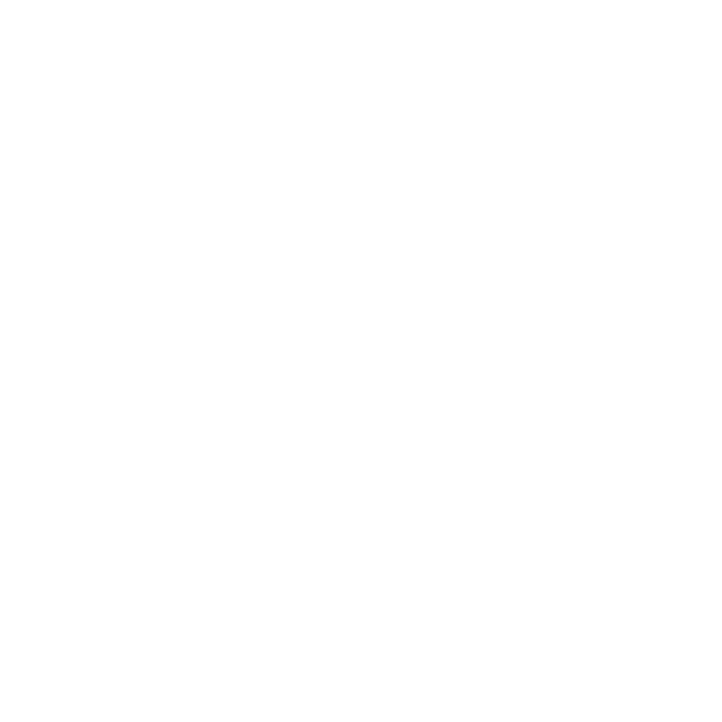
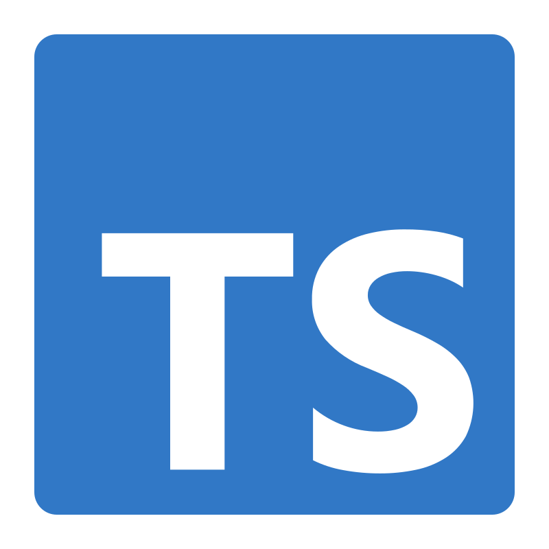
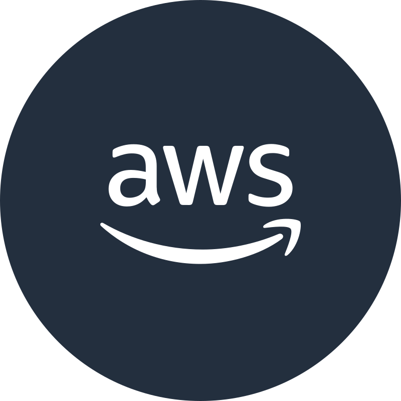
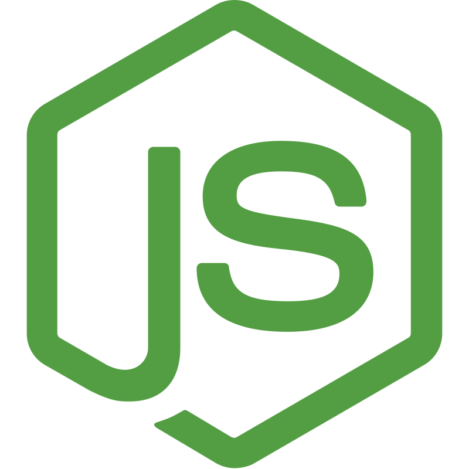
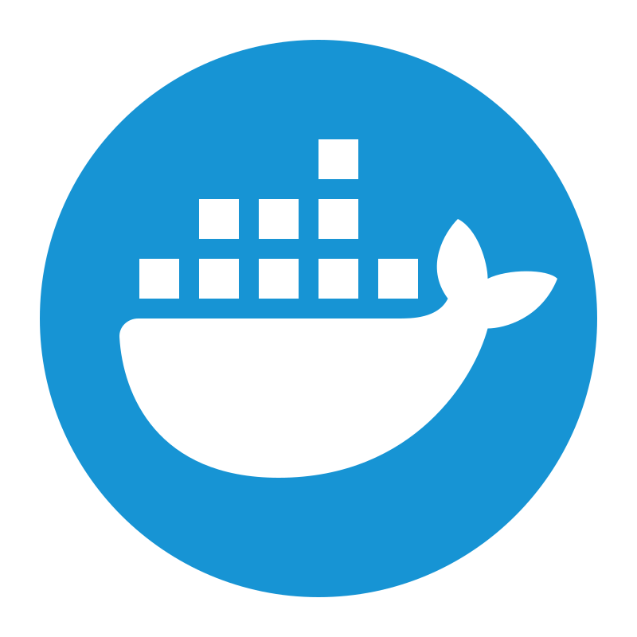
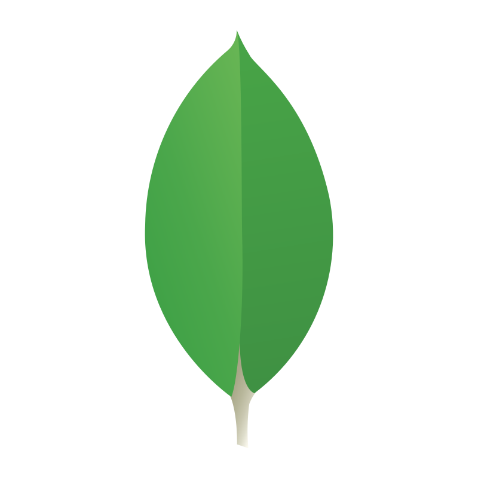
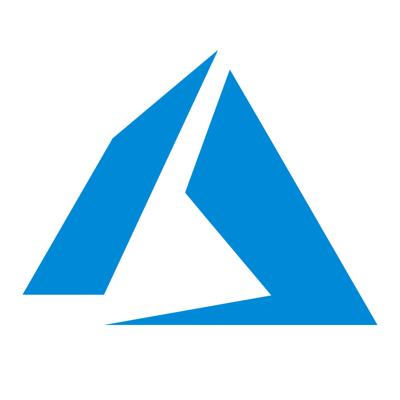

# Abeer Das

**Systems Design Engineering @ University of Waterloo** · BASc 2028

I build LLM/agent systems and the infra around them, including retrieval, orchestration, evals, and the cost of running it. Five terms in, currently an **AI Engineer at [Theory Ventures](https://theoryvc.com/)** in SF.

→ Previously a Product Engineer at [Spellbook](https://www.spellbook.legal/) and [BorderPass](https://borderpass.ai/), two of the Globe and Mail's fastest-growing startups, both in legal tech 
→ Building a volunteer & route management platform for [Beach Metro Community News](https://www.beachmetro.com/) @ UW Blueprint 
→ Building [**UW Wiki**](https://github.com/suryajj/uw-wiki), a student-edited knowledge base for UW clubs, design teams, and programs 

<h3 id="macropower-tech">Favorite tech</h3>

`Tools, languages, and other things that I like to work with.`

<table>
  <tr>
    <td align="center" width="96">
      
       NextJS
    </td>
    <td align="center" width="96">
      
       TypeScript
    </td>
        <td align="center" width="96">
      
       PostgreSQL
    </td>
        <td align="center" width="96">
      
       AWS
    </td>
    <td align="center" width="96">
      
       NodeJS
    </td>
    <td align="center" width="96"> 
      
       Docker
    </td>
    <td align="center" width="96">
      
       Mongo
    </td>
    <td align="center"  width="96">
      
       Azure
    </td>
  </tr>
</table>

**AI & Retrieval**

### Hackathon wins (pinned)

**[Sibyl](https://devpost.com/software/sibyl-x8gpor)** · *1st of 770 and Best Use of AI/ML, Hack for Humanity 2026*
Eight LangGraph agents verifying IFRS sustainability disclosures at paragraph level. A judge agent gates verdicts at a confidence threshold and sends thin evidence back for re-investigation.

**[Rosetta](https://devpost.com/software/rosetta-hq6aby)** · *3rd of 276, HackHive 2026*
Live lecture translation for ESL students, with grounded citations surfacing in under 150 ms.

### Elsewhere

[LinkedIn](https://www.linkedin.com/in/abeerdas) · [abeerkdas.com](https://abeerkdas.com/) · ak5das@uwaterloo.ca
